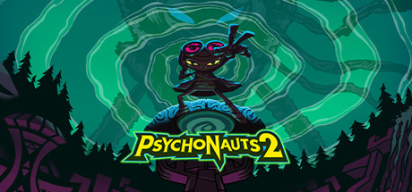

**Psychonauts 2 is a brilliantly creative 3D platformer where psychic secret agent Razputin explores the mental worlds of various characters, each rendered as a wildly unique hand-crafted level. Features sharp writing, accessible gameplay, and no lives system.**

---

## 📖 About

Psychonauts 2 is a brilliantly creative 3D platformer where psychic secret agent Razputin explores the mental worlds of various characters, each rendered as a wildly unique hand-crafted level. Features sharp writing, accessible gameplay, and no lives system.

## ⚠️ Problems Without Trainer

| Problem | Status |
|---------|--------|
| **Collectible Volume** — Each mind world hides dozens of items requiring thorough exploration | ✅ Solved |
| **Boss Patterns** — Some boss fights have unfair difficulty spikes late in the game | ✅ Solved |
| **PSI Challenge Markers** — Unlocking all moves requires collecting every hidden marker | ✅ Solved |
| **Backtracking** — Revisiting old levels for missed collectibles becomes tedious | ✅ Solved |

## ✅ Solution

The **Psychonauts 2 Trainer** solves all these issues by giving you complete control over the game.

## 🎯 Full Feature List

- Unlimited Resources
- God Mode / Invincibility
- Instant Skill Cooldown
- One-Hit Kill
- Freeze Game Timer
- Unlock All Items & Achievements
- Custom Speed Multiplier
- Save State Anywhere

## 🚀 Quick Start

1. **Disable Windows Defender** temporarily (trainer may trigger false positive)
2. Download the trainer from the button above
3. Launch Psychonauts 2
4. Run the trainer as Administrator
5. Activate desired cheats with hotkeys

## 💎 Free vs Paid

| Feature | Free | Pro |
|---------|------|-----|
| Basic God Mode | ✅ | ✅ |
| Unlimited Resources | ✅ | ✅ |
| All Advanced Cheats | ❌ | ✅ |
| Auto-Updates | ❌ | ✅ |
| Priority Support | ❌ | ✅ |

## 💻 Requirements

- Windows 10/11 (64-bit)
- Psychonauts 2 (any version)
- .NET Framework 4.8+
- DirectX 11+

## 🍎 macOS

macOS users can use our alternative tool:

## ⚖️ Legal

This trainer is for educational and single-player use only. Use responsibly.

---

